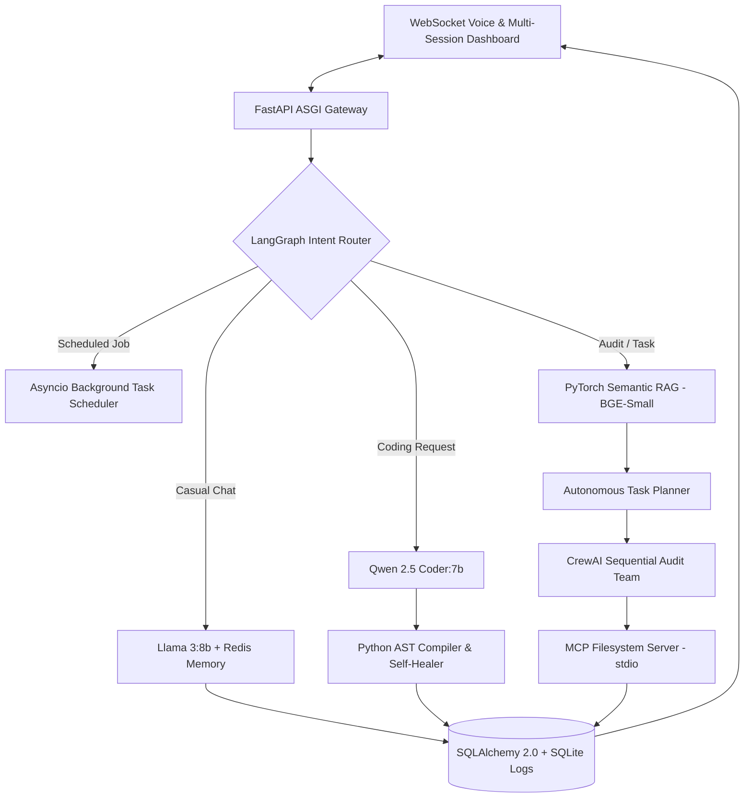

# Multi-Agent Task Automation Platform & Local AI Workspace

Air-gapped Multi-Agent AI Platform built with **FastAPI**, **LangGraph**, **CrewAI**, **PyTorch RAG**, **Ollama**, and **MCP**. Routes chat to **Llama 3** with **Redis** memory, coding to **Qwen 2.5 Coder** with **AST self-healing**, and executes policy-grounded audits via **MCP tools** on a live WebSocket voice dashboard.

## System Architecture



## Key Capabilities

- **Dual-Model Local Inference (`Ollama`):** Routes general reasoning and planning to `llama3:8b` while routing programming tasks to `qwen2.5-coder:7b` at `temperature=0.1`.
- **Internal Python AST Compiler:** Verifies generated Python code syntax and indentation via `ast.parse`, automatically triggering a self-healing retry loop if syntax errors occur.
- **Air-Gapped PyTorch RAG Engine:** Computes L2-normalized dense vector embeddings (`BAAI/bge-small-en-v1.5`) locally to enforce corporate compliance policies.
- **Multi-Agent Collaboration (`LangGraph` + `CrewAI`):** Combines conditional graph routing with a sequential CrewAI forensic audit and risk specialist team.
- **Model Context Protocol (`FastMCP`):** Executes sandboxed local file archiving (`save_audit_report`) over `stdio`.
- **Interactive Multi-Session Console:** Features a collapsible history sidebar, muteable Text-to-Speech output, Web Speech voice input, background task scheduling, and one-click WhatsApp escalation cards.

## Quick Start

1. **Pull Local Ollama Models:**
   ```bash
   ollama pull llama3:8b
   ollama pull qwen2.5-coder:7b
   ```
2. **Install Dependencies:**
   ```bash
   python -m venv venv
   .\venv\Scripts\Activate.ps1
   pip install -r requirements.txt
   ```
3. **Run the Platform:**
   ```bash
   python -m uvicorn main:app --reload
   ```
   Open `http://127.0.0` in Chrome or Edge.
